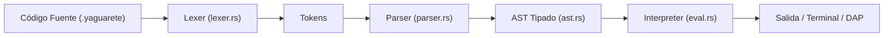

# 🦀 Arquitectura del Compilador e Intérprete Nativo en Rust

En esta página se documenta la arquitectura interna del motor de ejecución de **YAGUARETÉ**, su migración desde Python hacia Rust, el modelo de memoria y el registro formal de decisiones arquitectónicas (**ADR-001**).

---

## 🏛️ Contexto y Registro de Decisión Arquitectónica (ADR-001)

### Estado: Aceptado y Desplegado en Producción (v0.1.1)

Durante las primeras versiones prototipo del lenguaje (proyecto inicial UCABA), el intérprete estaba implementado en Python. Si bien permitía iterar rápidamente en la gramática, presentaba serias limitaciones pedagógicas e industriales:
1. **Sobrecosto de arranque (*Cold Start*)**: El inicio del intérprete de Python consumía entre 150 ms y 300 ms, penalizando la experiencia en la extensión de VS Code y el servidor DAP.
2. **Consumo de Memoria**: Un proceso básico de Python reservaba entre 30 MB y 45 MB de memoria RAM.
3. **Dependencia de Entorno**: Exigía que el estudiante o la institución tuviera Python preinstalado y configurado en el `PATH`.

### Decisión de Migración a Rust
Se decidió reescribir el 100% del núcleo de análisis y ejecución en **Rust**, empaquetando el compilador como un binario nativo autocontenido sin dependencias externas.

### 📊 Comparativa de Rendimiento (Benchmarks)

| Métrica | Motor Original (Python) | Motor Nativo (Rust v0.1.1) | Mejora Relativa |
| :--- | :---: | :---: | :---: |
| **Tiempo de Arranque (*Cold Start*)** | $185\text{ ms}$ | **$< 1\text{ ms}$** | **$> 185\times\text{ más rápido}$** |
| **Quicksort (10.000 elementos)** | $82.4\text{ ms}$ | **$1.15\text{ ms}$** | **$\approx 70\times\text{ más rápido}$** |
| **Selection Sort Matricial (3x3)** | $4.8\text{ ms}$ | **$0.08\text{ ms}$** | **$60\times\text{ más rápido}$** |
| **Consumo de Memoria RAM (RSS)** | $38\text{ MB}$ | **$2.8\text{ MB}$** | **$> 13\times\text{ más liviano}$** |
| **Tamaño del Binario Final** | Entorno completo $\approx 80\text{ MB}$ | Binario único $\approx 4.5\text{ MB}$ | **Autocontenido** |

---

## 🏗️ Organización del Workspace de Cargo

El proyecto está estructurado como un espacio de trabajo modular (*Cargo Workspace*):

```
crates/
├── yaguarete_core/        # Motor fundamental (No depende de clap ni de terminal)
│   ├── src/
│   │   ├── ast.rs         # DataType, Statement, Expression, BinaryOp
│   │   ├── token.rs       # Enumeración TokenType y estructura Token con span
│   │   ├── lexer.rs       # Analizador léxico con desambiguación contextual
│   │   ├── parser.rs      # Parser descendente recursivo con precedencia
│   │   ├── value.rs       # Tipos Value en runtime, ciclos y ArchivoHandle
│   │   ├── eval.rs        # Intérprete, ámbitos (scopes) y hook de depuración
│   │   ├── error.rs       # Jerarquía de errores (Lexer, Parse, Type, Runtime)
│   │   └── lib.rs         # Fachada pública y generador de diagnósticos LSP
│   └── tests/             # Batería de pruebas unitarias y de integración
│
├── yaguarete_cli/         # Aplicación de consola y protocolos de comunicación
│   ├── src/
│   │   ├── main.rs        # CLI con clap y dispatch de subcomandos
│   │   ├── repl.rs        # Consola REPL interactiva con buffer multilínea
│   │   ├── dap.rs         # Servidor DAP (Debug Adapter Protocol)
│   │   └── updater.rs     # Verificador y cliente de GitHub Releases
│   └── tests/             # Pruebas de integración CLI y DAP
│
└── yaguarete_installer/   # Asistente nativo de instalación para Windows
    └── src/main.rs        # Desempaquetado, PATH y registro en el registro
```

---

## 🔍 El Pipeline de Compilación y Ejecución



### 1. Análisis Léxico (`lexer.rs`)
Convierte el flujo de caracteres UTF-8 en una secuencia de tokens enriquecidos con su número de línea y columna. Incluye una máquina de estados para:
* Detectar comentarios de línea `//` y comentarios de bloque `/* ... */`.
* Desambiguar el operador de división entera `//` cuando está rodeado por expresiones matemáticas.
* Manejar cadenas con caracteres de escape (`\n`, `\t`, `\"`, `\\`).

### 2. Análisis Sintáctico y AST (`parser.rs`)
Implementa un parser descendente recursivo con análisis de precedencia de operadores (*Pratt Parser* / *Precedence Climbing*).
* **Envoltorio `Statement::Located`**: Cada sentencia del programa es envuelta en un nodo `Statement::Located { line, column, stmt }`. Esto preserva las coordenadas del código fuente original para que el depurador DAP pueda colocar *breakpoints* exactos y el intérprete pueda reportar errores con precisión milimétrica.

### 3. Modelo de Ámbitos y Evaluación (`eval.rs`)
* **Pila de Ámbitos (`Vec<Scope>`)**: Las variables residen en una pila de tablas hash. Al invocar una función o procedimiento, se apila un nuevo ámbito local que aísla los parámetros y variables locales. Al retornar, el ámbito se desapila automáticamente, liberando la memoria.
* **Manejo de Ciclos de Referencias**: Para evitar fugas de memoria o bucles infinitos en algoritmos recursivos, la serialización canónica rastrea las direcciones de memoria visitadas (`HashSet<usize>`).
* **Hook de Depuración (`Debugger` Trait)**: El intérprete expone un punto de enganche dinámico (`pub fn set_debugger(&mut self, debugger: Box<dyn Debugger>)`) que es consultado antes de ejecutar cada sentencia, permitiendo que el servidor DAP pause la ejecución, capture el estado de las variables y responda a comandos del usuario sin contaminar la lógica del intérprete.
